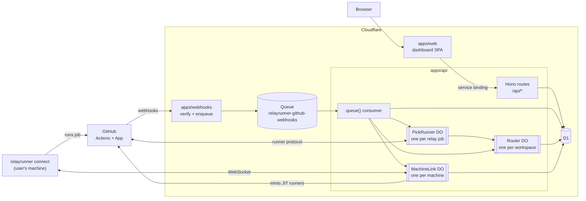

# RelayRunner architecture

These docs explain how the important parts of RelayRunner work, for people who review the code more than they write it. Each one covers the flow, the decisions behind it and what happens when it breaks, then links to the code. They don't replace the code or the app READMEs, which cover how to run and deploy each app.

| Doc                   | What it covers                                                                              |
| --------------------- | ------------------------------------------------------------------------------------------- |
| [Routing](routing.md) | How a job asks where to run, how the runner order is walked, and how a machine gets the job |

## The system on one page

RelayRunner is five Cloudflare Workers in one account, plus a CLI that runs on users' machines.

- **`apps/webhooks`** is the only thing GitHub's webhooks reach. It checks the signature, trims the payload to a `WebhookMessage` and puts it on a queue. It's kept small so API deploys and API bugs never change what GitHub sees: while the API is broken, messages wait and retry instead of failing deliveries.
- **`apps/api`** does all the work. Its HTTP side serves the dashboard and the CLI. Its `queue()` side processes webhooks. Three Durable Objects hold the state that needs one owner:
  - **PickRunner**, one per relay job. It acts as a one-job runner that answers the relay without running anything.
  - **Router**, one per workspace. It walks the runner order, picks machines one decision at a time and keeps the routes it hands out.
  - **MachineLink**, one per enrolled machine. It holds the machine's WebSocket, so an open socket means the machine is online.
- **`apps/web`** serves the dashboard and forwards `/api/*` to the API over a service binding, so the browser sees one origin and auth cookies stay first-party.
- **`apps/cli`** is the `relayrunner` npm package. `relayrunner connect` signs a machine in to a workspace and keeps it connected; when the gateway sends it a job, it starts a fresh GitHub runner for that one job.
- **`apps/landing`** is the marketing site and has no part in the system.
- **D1** is the one database: users, workspaces, installations, repos, machines, jobs and activity.

Shared code lives in `packages/`: `runner-order` (the order's schema), `machine-protocol` (the CLI's WebSocket messages), `github-webhooks` (the queue message), `activity` (event types the dashboard explains), `access` (the Cloudflare Access gate on admin views) and `email`.

## A job's path in one paragraph

A workflow opts a job in by adding a relay job (`relayrunner/actions`' `relay.yml`) that asks for the `relayrunner` label, and pointing the real job's `runs-on` at the relay's output. GitHub sends a `workflow_job` webhook, which reaches the API through the queue. A PickRunner registers as a runner, claims the relay job, asks the workspace's Router where the run should go and completes the relay with that answer as its output. The real job then queues on that label: a GitHub-hosted or Blacksmith label runs as usual, and a machine's one-time label makes the machine's MachineLink start a runner for it. [Routing](routing.md) has the details.

## Keeping these docs current

Each doc starts with a **Covers** line listing the code it describes. When a change alters behavior a doc describes, update the doc in the same pull request (see `AGENTS.md`). Refactors and fixes that keep the behavior don't need a doc change.

Write for a reader who knows GitHub Actions but hasn't read this code. Explain what happens and why, keep code detail to what the reader needs to find their way, and link the code rather than copying it. Each doc uses the same sections: what it does, a diagram, the flow, decisions and why, failure modes, and code.
