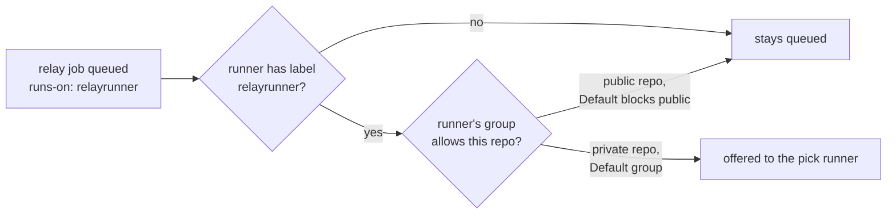
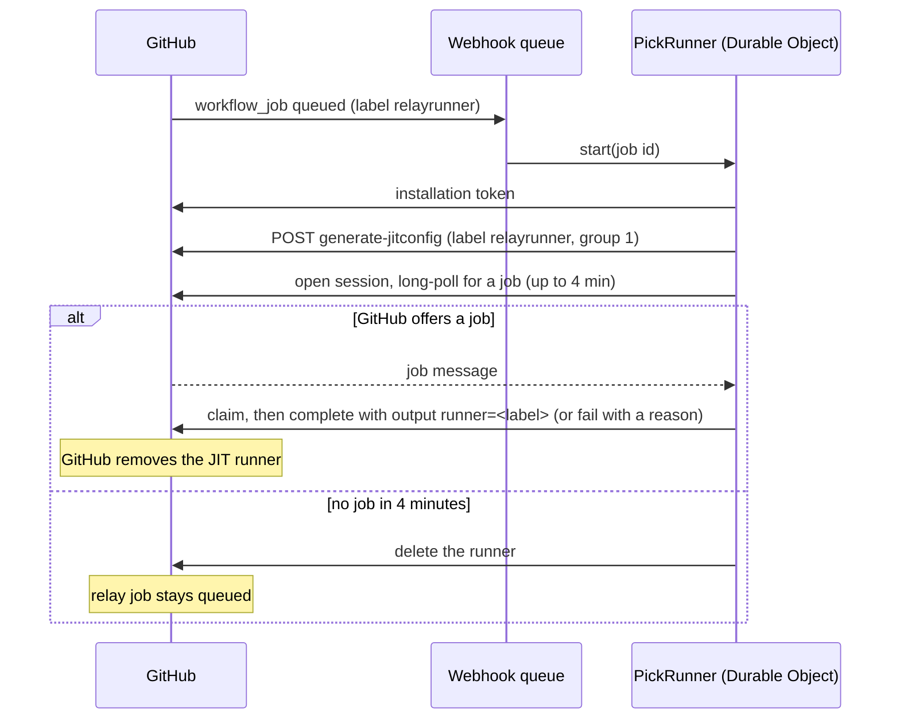

# Pick runner

**Covers:** `apps/api/src/durable-objects/pick-runner.ts`, `apps/api/src/github-app.ts` (`generateOrgJitConfig`, `deleteOrgRunner`, `DEFAULT_RUNNER_GROUP_ID`, runner groups), `apps/api/src/runner-protocol.ts`, and the `queued` path in `apps/api/src/webhook-queue.ts`.

## What it does

The pick runner is how RelayRunner gets hold of a `relay` job. Every relay job asks for `runs-on: relayrunner`, and GitHub only hands a job to a runner registered with a matching label. So for each queued relay job, the gateway registers its own one-job runner with the `relayrunner` label, claims the job, and completes it with a `runner` output. It never runs a step.

The pick runner is the piece that decides, so it has to get the job before anything can be chosen. If GitHub never offers the relay job to the pick runner, nothing is routed: no machine, no GitHub-hosted runner, no Blacksmith. The relay job just stays queued.

## Who gets the job: labels and runner groups

GitHub offers a queued job to a self-hosted runner only when **both** of these hold:

1. **The labels match.** The job's `runs-on` labels are all on the runner. The pick runner has exactly one label, `relayrunner`. GitHub adds no `self-hosted`, OS or arch defaults to a JIT runner, so ordinary `runs-on: self-hosted` jobs can't land on it.
2. **The runner's group allows the repo.** Every org runner lives in exactly one runner group, and the group says which repos may use its runners:
   - **Repository access:** all repos, or selected repos only.
   - **Allow public repositories:** off by default. While it's off, no public repo's job reaches any runner in the group.
   - **Workflow access:** optionally, only selected workflows.

The pick runner always registers in the org's **Default** group (`runner_group_id: 1`). Default allows private repos only until an org admin turns on "Allow public repositories" (Organization settings → Actions → Runner groups → Default). Machine runners (`apps/api/src/durable-objects/machine-link.ts`) register in Default too.

| Repo                           | Label matches | Default allows the repo | Result                                     |
| ------------------------------ | ------------- | ----------------------- | ------------------------------------------ |
| relayrunner-ci-tests (private) | yes           | yes                     | Pick runner claims the relay and routes it |
| relayrunner, actions (public)  | yes           | no                      | Never offered; `no-job` after 4 minutes    |

Orgs on GitHub Free can't create extra runner groups. Default is the only one they have, and its settings apply to every self-hosted runner in the org. Personal accounts have no runner groups. Their runners are registered per repo, which this code doesn't do yet (#68).

## The flow

1. **The relay is queued.** GitHub sends a `workflow_job` `queued` webhook for the relay job. The queue consumer sees the `relayrunner` label and starts a `PickRunner` named after the job id. `start()` is idempotent, so a redelivered webhook does nothing.
2. **It registers a runner.** The PickRunner mints an installation token for the job's installation. It then calls `POST /orgs/{org}/actions/runners/generate-jitconfig` with the name `relayrunner-pick-<job id>`, the labels `["relayrunner"]` and `runner_group_id: 1`. The runner shows in the org's runner list while it waits.
3. **It is the runner.** No VM or runner binary is involved. The Durable Object decodes the JIT config and speaks GitHub's runner protocol itself (`RunnerClient` in `runner-protocol.ts`). It opens a session and long-polls in 60-second polls, for up to 4 minutes.
4. **It claims a job.** GitHub may offer any queued job in the org that passes the two checks above, including another repo's relay. The route is therefore always taken from the claimed job's own context (repo, run, relay inputs), not from the webhook that woke the PickRunner.
5. **It answers.** A job made only of `relayrunner/actions/checks/*` steps is run here and completed as passed or failed. Otherwise the workspace's Router walks the runner order (see routing), and the job is completed with output `runner=<label>`, or failed with a reason. The decision is recorded for the Activity page.
6. **It cleans up.** GitHub removes a JIT runner once its one job is done. If no job arrived, the PickRunner deletes the runner. Either way it logs `relayrunner pick finished` with a `result`: `routed`, `no_runner`, `check_passed`, `check_failed`, `no-job` or `error`.

## Decisions and why

- **One JIT runner per job, not a long-lived runner.** A JIT config works for a single job, so there is no runner credential to store or rotate. Nothing polls GitHub while CI is idle. Parallel relays get parallel runners, because a runner session takes one job at a time anyway. Runners that crash don't linger as offline entries. The cost is a few seconds and a couple of API calls per job, and a dependence on the `queued` webhook (see failure modes).
- **A Durable Object instead of a real runner.** Picking needs no machine, only the runner protocol, so a Worker can answer a relay in seconds without paying for a VM.
- **The pick never runs code from the job.** It only reads the job message and completes it. That is what would make it safe to expose to public repos and fork PRs, which is not true of machine runners or vanilla self-hosted runners.
- **Default group.** Every org has it, including Free orgs, and the App can register in it with only the "Self-hosted runners" org permission. The cost is that the group's repo access settings decide which repos the pick can serve, and today that excludes public repos.

## Failure modes

- **Public repo, Default blocks public repos.** GitHub never offers the relay. The PickRunner logs `no-job` after 4 minutes, and the relay job stays queued on GitHub until someone cancels it or GitHub's 24-hour queue limit ends it. The run shows no error message. RelayRunner's own CI in relayrunner/relayrunner and relayrunner/actions hit this on 2026-11-06.
- **Default limited to selected repos or selected workflows.** This fails the same way for any repo or workflow outside the list.
- **The `queued` webhook is lost.** No pick runner is registered, and the relay stays queued. Nothing sweeps for relay jobs left without a pick runner yet (compare #71 for machine jobs).
- **Another runner in the org has the `relayrunner` label.** It could take relay jobs instead of the gateway. GitHub picks among matching runners, and RelayRunner doesn't prevent it.
- **The installation lacks "Self-hosted runners: write" on the org.** `generate-jitconfig` fails, and the pick logs `result: error`.

## Code

- `apps/api/src/webhook-queue.ts`: `queued` webhooks with the `relayrunner` label start a PickRunner.
- `apps/api/src/durable-objects/pick-runner.ts`: registration, waiting, claiming, answering, cleanup, the `relayrunner pick finished` log.
- `apps/api/src/github-app.ts`: `generateOrgJitConfig`, `deleteOrgRunner`, `DEFAULT_RUNNER_GROUP_ID`, `listOrgRunnerGroups`. The group reader doesn't read `allows_public_repositories` yet.
- `apps/api/src/runner-protocol.ts`: `RunnerClient` (session, poll, claim, complete) and `decodeJitConfig`.
- `apps/api/src/native-checks.ts`: jobs answered as checks instead of routed.
