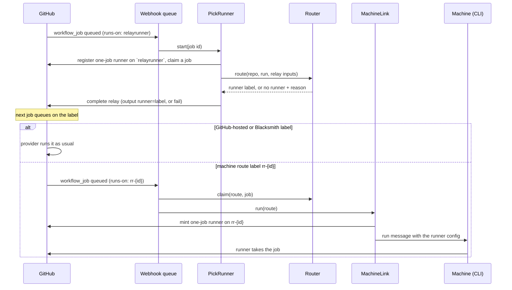

# Routing

**Covers:** `apps/api/src/durable-objects/pick-runner.ts`, `apps/api/src/durable-objects/router.ts`, `apps/api/src/routing.ts`, `apps/api/src/webhook-queue.ts` (the `workflow_job` path), `packages/runner-order/`, and `relay.yml` in [relayrunner/actions](https://github.com/relayrunner/actions).

## What it does

Routing decides where a job runs: one of the workspace's machines, GitHub-hosted runners or Blacksmith. GitHub has no hook for choosing a runner, so RelayRunner works inside GitHub's own model. A workflow adds a small relay job ahead of the real job, RelayRunner answers the relay with a runner label, and the real job uses that label as its `runs-on`.

```yaml
jobs:
  relay:
    uses: relayrunner/actions/.github/workflows/relay.yml@v1
    with:
      machine: macOS, ARM64 # labels a machine must have, all of them
      github: macos-latest # the GitHub-hosted fallback
  test:
    needs: relay
    runs-on: ${{ needs.relay.outputs.runner }}
```

The job names which providers may run it, through one relay input per provider. The workspace's **runner order**, set on the dashboard's Runners page, decides which to try first.

## The flow



1. **The relay is queued.** The relay job asks for `runs-on: relayrunner`. GitHub sends a `workflow_job` `queued` webhook, which the ingress Worker puts on the queue. The consumer wakes a PickRunner named after the job id.
2. **PickRunner claims a relay job.** It uses the GitHub App's installation token to register a just-in-time (one-job) runner on the `relayrunner` label in the job's org, then talks GitHub's runner protocol to wait for and claim a job. GitHub hands a runner any pending job with its label, so the claimed job may belong to a different repo in the same org; the route is always for the claimed job's own repo and run.
3. **Native checks short-circuit.** If every step of the claimed job is a `relayrunner/actions/checks/*` step, PickRunner runs the check itself and completes the job as passed or failed. Nothing is routed.
4. **Router walks the runner order.** PickRunner reads the repo and run from the job's context and the relay's `machine`, `github` and `blacksmith` inputs, finds the workspace that owns the installation, and asks that workspace's Router for a route. See [Walking the runner order](#walking-the-runner-order).
5. **The relay completes.** With a runner, PickRunner completes the relay as succeeded with output `runner=<label>`. With none, it fails the relay with the reason, so the real job never starts. The decision is saved for the Activity page.
6. **The real job runs.** GitHub queues the next job on the label:
   - A **GitHub-hosted** or **Blacksmith** label runs through that provider as normal. RelayRunner only watches its webhooks for Activity.
   - A **connected machine's** route label, `rr-<12 hex>`, triggers another `queued` webhook. The consumer asks the Router to claim the route for this job, then asks the machine's MachineLink to run it. MachineLink mints a one-job runner on that label and sends its config down the machine's WebSocket. The CLI starts the runner and GitHub delivers the job.
   - An **existing self-hosted runner** added from GitHub has a permanent label of its own, `rr-runner-<8 hex>`. GitHub delivers the job straight to that runner through its usual long poll. The consumer only claims the route so the Router knows the runner is spoken for.

## Walking the runner order

The runner order is an ordered allowlist of providers (`packages/runner-order`). A workspace that never saved one gets **Self-hosted, then GitHub-hosted**. The Router tries each step top to bottom, and the first that can take the job wins:

| Step          | Takes the job when                                                                                                                              | Otherwise skipped as                                            |
| ------------- | ----------------------------------------------------------------------------------------------------------------------------------------------- | --------------------------------------------------------------- |
| Self-hosted   | The relay sets `machine`, the repo is private, and an online, idle, unpaused machine has every label in `machine`. The answer is a route label. | `not_configured`, `public_repo`, `machine_paused`, `no_machine` |
| GitHub-hosted | The relay sets exactly one `github` label. The answer is that label.                                                                            | `not_configured`, `too_many_labels`                             |
| Blacksmith    | The relay sets exactly one `blacksmith` label that starts with `blacksmith-`. The answer is that label.                                         | `not_configured`, `too_many_labels`, `not_blacksmith_label`     |

If no step answers, the relay fails with one message naming why each provider couldn't take it, plus any provider the job set that the order leaves out. Every skip is kept, so the Activity page can say why a job went where it did.

**Choosing a machine.** Machine labels follow GitHub's self-hosted defaults (`self-hosted`, `macOS`, `ARM64`, and so on), compared without case, so a job's old `runs-on` can be pasted into `machine` as-is. `self-hosted` alone matches any machine. Among the machines that fit, the Router takes the one picked least recently, so work spreads across machines. Connected machines report whether they're online and idle through their MachineLink. Added GitHub runners are read live from GitHub's API, and only count when their runner group lets the job's repo use them.

**Routes.** A machine pick creates a route: the machine, plus the repo and run it was picked for. A route is `reserved` until its job is queued, `dispatched` once that job claims it, and `done` when the machine reports the job started. A route holds its machine for up to 10 minutes, so two runs can't both get the same idle machine. Routes are kept for 24 hours, so a redelivered webhook still finds them.

## Decisions and why

- **The relay is answered by a fake runner, not a workflow step.** PickRunner claims the relay job and completes it without running steps, so the relay takes about a second and bills no runner minutes.
- **The job names its providers and the dashboard orders them.** A job can only run where its workflow says it can (labels come from the workflow), but the workspace can reorder or drop providers without a commit. A provider the job didn't name, or that isn't in the order, is never used.
- **Fail fast instead of queueing.** A job no provider can take fails its relay with a reason. A job left queued on a label nothing serves would sit there until GitHub cancels it after a day.
- **Public repos never go to a machine.** Anyone can open a pull request on a public repo, which would let them run code on a team member's laptop.
- **A route label only works for its own repo and run.** The Router gives a route to a job from the same repo and run as the pick that made it, and only to one job. Another repo can't borrow a machine by copying an `rr-` label, and one relay routes exactly one job.
- **One Router per workspace, one decision at a time.** The machine pick runs under `blockConcurrencyWhile`, so two picks can't see the same machine as free.
- **Blacksmith is label-only.** Blacksmith has no API to ask whether it can take a job, so its step accepts any `blacksmith-*` label and leaves the rest to Blacksmith's own GitHub App.
- **Webhooks are processed idempotently.** Delivery is at least once and unordered, so PickRunner ignores a second `start` for the same job, MachineLink refuses to mint a second runner for a route it already sent, and claiming a route again with the same job returns the same route.

## Failure modes

| What happens                                                  | Result                                                                                                                     |
| ------------------------------------------------------------- | -------------------------------------------------------------------------------------------------------------------------- |
| The installation isn't linked to a workspace                  | The relay fails: "this GitHub App installation isn't connected to a RelayRunner workspace".                                |
| RelayRunner can't see the repo                                | The relay fails: "RelayRunner doesn't have access to `owner/repo`".                                                        |
| No relay job reaches the PickRunner within 4 minutes          | Its one-job runner is deleted and the pick ends with `no-job`. Another pick usually claimed the job.                       |
| The machine goes offline between the pick and its job         | MachineLink reports `offline` and the job stays queued on its `rr-` label. Nothing moves it to another provider.           |
| The route expires or the label is used by another repo/run    | The claim returns nothing and the job stays queued. It isn't RelayRunner's to run.                                         |
| GitHub's runner API is down during a pick                     | Added GitHub runners sit that pick out. Connected machines and the other providers still work.                             |
| The API Worker errors while processing a webhook              | The queue retries with backoff (30 s doubling, about half an hour in all), then dead-letters the message to R2 for replay. |
| An ordinary runner with the `relayrunner` label takes a relay | The relay's only step runs and fails with "RelayRunner didn't answer this relay".                                          |

## Code

- [`apps/api/src/webhook-queue.ts`](../../apps/api/src/webhook-queue.ts): sorts each `workflow_job` into a relay (`relayrunner`), a machine route (`rr-<id>`) or an added runner (`rr-runner-<id>`).
- [`apps/api/src/durable-objects/pick-runner.ts`](../../apps/api/src/durable-objects/pick-runner.ts): the one-job runner that answers the relay.
- [`apps/api/src/runner-protocol.ts`](../../apps/api/src/runner-protocol.ts): the client for GitHub's runner protocol (session, poll, claim, complete).
- [`apps/api/src/durable-objects/router.ts`](../../apps/api/src/durable-objects/router.ts): the per-workspace Router, its machine pool and its routes.
- [`apps/api/src/routing.ts`](../../apps/api/src/routing.ts): the pure logic, `decideRoute`, `chooseMachine`, routes and labels, with its tests.
- [`apps/api/src/github-runners.ts`](../../apps/api/src/github-runners.ts): added GitHub runners, their routing labels and runner group access.
- [`apps/api/src/durable-objects/machine-link.ts`](../../apps/api/src/durable-objects/machine-link.ts): `run()`, which mints the machine's one-job runner and sends it down the socket.
- [`apps/api/src/route-decisions.ts`](../../apps/api/src/route-decisions.ts): what a pick saves for the Activity page.
- [`packages/runner-order`](../../packages/runner-order/src/index.ts): the order's schema and default.
- [`relay.yml`](https://github.com/relayrunner/actions/blob/main/.github/workflows/relay.yml): the reusable relay workflow and its inputs.
